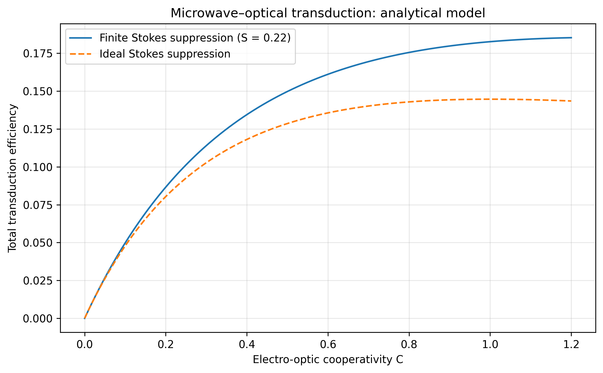

# Microwave–Quantum Transduction Simulation

**Numerical modeling of microwave–optical transduction using coupled-mode quantum dynamics and an analytical conversion-efficiency model.**

This project explores how microwave and optical modes exchange excitations, how thermal environments affect mode populations, and how electro-optic cooperativity and Stokes-process suppression influence predicted transduction efficiency.

> **Project status:** Educational numerical study with analytical-model implementation and numerical validation checks. Experimental reproduction is not yet established.

## Results at a Glance

The figure below compares the analytical model's predicted total transduction efficiency for finite and ideal Stokes-process suppression.

*Figure 1. Analytical transduction efficiency versus electro-optic cooperativity. The curves show the implemented model under finite Stokes suppression (S = 0.22) and the ideal-suppression limit.*

The model predicts different efficiency curves depending on the degree of Stokes-process suppression. The plotted results are generated from the analytical equation and parameters specified in the notebook; they should not be interpreted as a direct fit to experimental measurements.

## Research Motivation

Microwave–optical quantum transduction aims to transfer quantum information between microwave-frequency systems and optical-frequency systems. Such interfaces are relevant to research on superconducting quantum circuits and optical communication.

This project investigates selected theoretical and computational aspects of that problem through two distinct modeling components:

1. **Coupled-mode dynamics:** Simulates microwave and optical mode populations using QuTiP.
2. **Analytical transduction model:** Evaluates a published conversion-efficiency expression and examines the effect of Stokes-process suppression.

These components address related physics but are not a single fully integrated experimental model.

## Objectives

- Simulate coherent excitation exchange between microwave and optical modes.
- Examine open-system dynamics with dissipation and thermal excitation.
- Compare numerical steady-state occupations with an analytical benchmark.
- Implement an analytical electro-optic conversion-efficiency expression.
- Compare finite and ideal Stokes-process suppression.
- Export computed results to CSV for further analysis.

## Mathematical Model

### 1. Coupled-mode quantum dynamics

The notebook uses a two-mode interaction Hamiltonian of the form

\[
H = \hbar G(a_m^\dagger a_o + a_m a_o^\dagger)
\]

where:

- \(a_m\) and \(a_m^\dagger\) are microwave-mode annihilation and creation operators.
- \(a_o\) and \(a_o^\dagger\) are optical-mode annihilation and creation operators.
- \(G\) is the coherent coupling rate.

Dissipation and thermal excitation are included through collapse operators in the open-system simulation.

The calculation uses a truncated Fock-space representation. Results therefore depend on the chosen parameters and the adequacy of that truncation.

### 2. Analytical transduction efficiency

The notebook implements the following analytical expression reported in the reference study:

\[
\eta_{\mathrm{tot}} =
\eta_o\eta_e\Lambda^2
\frac{4C(1+C_J^{-1})^2}
{(1+C+C_J^{-1})^2}
\]

where:

- \(\eta_{\mathrm{tot}}\) is the modeled total transduction efficiency.
- \(C\) is the electro-optic cooperativity.
- \(C_J\) characterizes the auxiliary-mode coupling used for Stokes-process suppression.
- \(\eta_e\) and \(\eta_o\) represent microwave and optical coupling efficiencies.
- \(\Lambda\) is a mode-overlap parameter.

The ideal-suppression curve is calculated by taking the limit \(C_J\rightarrow\infty\):

\[
\eta_{\mathrm{ideal}} =
\eta_o\eta_e\Lambda^2\frac{4C}{(1+C)^2}
\]

The finite-suppression and ideal-suppression curves allow the effect of the suppression mechanism to be examined within this analytical model.

## Numerical Validation

The notebook includes checks for:

- Finite numerical outputs.
- Non-negative and physically bounded conversion efficiencies.
- Zero efficiency at zero cooperativity.
- Agreement with the ideal-suppression limit at large \(C_J\).
- Numerical versus analytical steady-state mode populations.

These tests help identify implementation errors and check expected limiting behavior. They do not independently establish physical accuracy or agreement with experimental measurements.

## Repository Contents

| File | Description |
|---|---|
| `microwave_quantum_transduction_simulation.ipynb` | Executable notebook containing the simulations, analytical model, plots, and validation checks |
| `transduction_efficiency_results.csv` | Generated efficiency sweep for finite and ideal suppression |
| `transduction_efficiency_comparison.png` | Comparison plot displayed above |
| `README.md` | Project overview, mathematical formulation, methodology, and limitations |

## Getting Started

### Requirements

- Python 3
- NumPy
- SciPy
- Matplotlib
- pandas
- QuTiP

### Run in Google Colab

1. Open the notebook from this repository.
2. Open it in Google Colab.
3. Run the dependency-installation and import cells.
4. Execute the coupled-mode simulation and analytical-model cells in order.
5. Run the validation cells.
6. Execute the export cells to regenerate the CSV and plot.

The notebook includes setup cells for installing the required Python packages.

## Limitations and Future Work

This is an exploratory computational project rather than a complete reproduction of the reference experiment.

Potential next steps include:

- Comparing calculations against numerical data released with the reference paper.
- Reproducing selected published figures using documented parameters.
- Investigating parameter sensitivity and uncertainty.
- Checking Fock-space truncation convergence.
- Extending the model to include additional modes and experimentally relevant noise processes.
- Adding automated tests and a documented environment for reproducible execution.

Any quantitative claim of agreement with an experiment should be supported by a reproducible comparison with the original data or published measurements.

## Reference

Sahu et al., **“Quantum-enabled operation of a microwave-optical interface.”** *Nature Communications* (2022).

[https://doi.org/10.1038/s41467-022-28924-2](https://doi.org/10.1038/s41467-022-28924-2)

## Author 
Aman Kumar 

Indian Institute of Technology, Madras, India 

Department of Electronic Systems 
